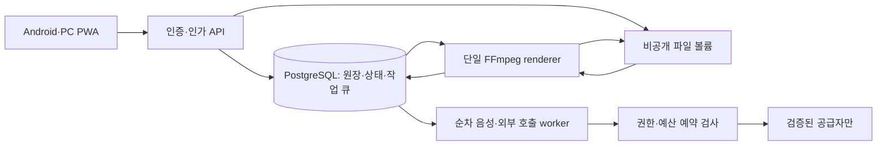

# TASK-1 저장소 조사와 최소 기술 구성 결정

조사일: 2026-10-19 UTC. 범위: 조사·설계만. 제품 구현, 실기기 시험, 유료 호출, 운영 변경, DNS, 배포는 수행하지 않았다. 이 문서의 설계 완료는 기능 출시 승인이 아니다.

## 1. D01-01 — 입력과 실제 저장소

| 항목 | 실제 확인 결과 |
| --- | --- |
| 작업 경로 | `/workspace` — 제공된 격리 checkout, 시작 시 detached HEAD |
| origin (fetch/push) | `https://github.com/vaynel/daily_log.git` |
| 기준 commit | `686e92da29b72154182682dced58d8913193975b` |
| 기준 tree | `4b825dc642cb6eb9a060e54bf8d69288fbee4904` (빈 tree) |
| 마지막 제목 | `chore: initialize daily log runner baseline` |
| 추적 파일/초기 변경 | `git ls-files`, `git ls-tree -r HEAD`, `git status --short` 모두 출력 없음 |
| 지침 | `/AGENTS.md`, `/workspace/AGENTS.md` 없음. 제공된 Task 패킷 적용 |
| 실행·테스트 | README, package manifest, lockfile, 소스, 테스트, CI 없음. 실행 명령 및 제품 테스트 없음 |
| 재사용 범위 | 제품 코드 재사용 0. origin·빈 기준 커밋만 계승; 새 앱 구조는 후속 구현 |

조사 명령은 [검증 기록](validation.md)에 수록한다. `.git`은 러너가 제공한 worktree 메타데이터 포인터이다. 호스트처럼 보이는 경로는 서버 접근 증거가 아니며 변경하거나 복제하지 않았다. 작업 산출물과 추가 의존성은 `/workspace` 안에만 둔다(이번 작업 의존성 추가 없음).

읽은 프로젝트 입력:

- scoped Mandu `list_tasks`, `get_task`, `begin_task`의 TASK-1 scopeRevision 2, 담당 역할·참조·고정 스킬 패킷.
- run `bf7927b1-2f6c-4731-ab26-d11c6313848b`, packet SHA256 `b226e66ad57cd0a69ed6a6b5ce9f5673eee157f3c1a26537988d215c11947046`.
- 읽기 전용 `/run/mandu/MANDU-HANDOFF.json`: seed commit/tree가 실제 checkout과 일치. 이 파일을 수정하거나 checkout 사본으로 대체하지 않았다.
- 공용 Task 계획의 D01-01~04. 개인 Todo나 경과 시간은 완료 증거로 사용하지 않는다.

참조 공백: Wiki 00~09와 Flowchart 원문은 번들에 없고 현재 scoped MCP에 Wiki/report/flowchart 조회 도구가 없다. 특히 Wiki 07 v4 `cmvdw9il30029w93obqmrwgmm`, Wiki 08 v5 `cmvdw9iz9002cw93ou34wat42`는 식별자만 전달되었다. 원문을 읽었다거나 대조 완료했다고 주장하지 않는다. 아래 결정은 Task 패킷의 명시 요구를 기준으로 하며, 후속 구현 전에 PM/QA가 원문과 대조해야 한다. 호스트의 제외된 `.claude/`, `.gitignore`, `docs/`, AGENTS도 조사하지 않았다.

적용한 고정 스킬: verification-before-completion(실제 명령 확인), using-git-worktrees(기존 격리 공간 유지), api-design-principles(API·멱등성·인가), error-handling-patterns(실패 상태 분리). 제품 코드 변경이 없어 TDD·속성 테스트·CI 예제 도입은 해당하지 않는다.

## 2. D01-02 — 앱 후보와 결정

결정: 첫 구현 기본안은 **React + TypeScript + Vite의 반응형 PWA**, **Node.js + Fastify API/작업 프로세스**, **PostgreSQL 작업 테이블**, **전용 비공개 파일 볼륨**, **FFmpeg 단일 렌더러**다. 제품 코드·패키지·버전은 아직 설치하지 않았다. 구현 착수 시 지원 중인 런타임과 의존성 버전을 확인하고 lockfile을 고정한다. React/Fastify 선택은 공용 언어·명시적 API 경계·작은 운영 단위를 선호한 설계 판단이며 성능 비교 실험 결과가 아니다.

| 후보 | Android·PC 경로 | 음성·첨부·알림 | 판단·전환 조건 |
| --- | --- | --- | --- |
| React PWA (선정) | Android 브라우저/설치형 웹, PC 브라우저 | 권한 기반 마이크, 사진 파일·메모 입력, Service Worker Push 후보 | 하나의 UI 배포 경로. 전경 대화 우선; OS 절전·잠금 중 녹음과 알림 도착 시간 보장 없음. 실기기 검증 필수 |
| React + Capacitor | Android 네이티브 컨테이너 + PC 웹 | 웹 UI 재사용과 네이티브 플러그인 연동 후보 | PWA 실기기 검증 실패 또는 백그라운드 요구 확정 시 대안. Android 빌드·서명·권한·플러그인 유지 비용 추가. 플러그인 동작은 미검증 |
| Flutter | Android 및 데스크톱/웹 대상 | 플랫폼별 녹음·파일·알림 연동 검증 필요 | 공식 지원 플랫폼은 넓지만 Dart와 플랫폼별 빌드 체계 추가. 기존 코드 없는 현재 웹 우선 목적에는 보류; 네이티브 요구가 커지면 재평가 |

PWA의 지원 목표는 Android Chrome와 PC Chrome/Edge 전경 사용이다. 실제 버전별 지원 표는 실기기 후속 시험에서 확정한다. 모든 PC 운영체제·브라우저, 화면 잠금 상태 또는 상시 음성 호출을 지원한다고 선언하지 않는다. 권한 거부·기기 없음·무응답에서는 녹음 대기와 명시적 취소/메모 입력을 제공한다. 첨부 MIME·크기는 클라이언트 안내와 서버 검증을 함께 하고 모바일 사진 촬영 UX도 실기기에서 확인한다.

약 10분 대화는 **녹음 시작/종료 → 전송 → STT → 당일 내용으로 응답 생성 → TTS 재생 → 다음 발화**의 순차 상태로 처리한다. 응답 재생 동안 녹음하지 않아 에코·중복 발화를 줄인다. 버튼을 기본 수단으로 두고, 인식된 음성 명령은 같은 서버 명령 계약을 사용한다. 상시 wake word나 동시 양방향 실시간 음성은 기본안에 포함하지 않는다. 네트워크 단절 시 마지막 확정 턴과 미전송 상태를 구분해 복구하고, 새로운 턴을 성공으로 꾸미지 않는다.

통합 브리핑을 사용자가 1회 확인한 **정확한 revision**만 제작한다. 당일 내용만 사용하며 불확실한 사실과 정치·타인 비방·뒷담화·형사 소송 관련 내용은 영상에서 제외한다. 사이버보안 학습은 일괄 차단하지 않는다. 사진 재스케치·고정 캐릭터/동일 의상·정해진 움직임·같은 AI 목소리의 담담한 1인칭 내레이션·자막으로 9:16, 최대 180초 영상을 합성한다. 음악과 AI 동영상 생성 서비스는 사용하지 않는다. 다음날 검토할 영상은 자동 공개하지 않는다.

## 3. 근거와 검증 전 가정

2026-10-19에 아래 공식/플랫폼 문서를 열어 해당 내용을 확인했다. 문서는 일반 기능 근거이며 이 제품의 지원·성능 시험 결과가 아니다.

| 근거 | 확인 내용 | 설계에 반영한 점 |
| --- | --- | --- |
| [MDN getUserMedia](https://developer.mozilla.org/en-US/docs/Web/API/MediaDevices/getUserMedia) | 보안 컨텍스트·사용자 권한 필요, 기기/권한 실패 또는 권한 선택 무응답 가능 | HTTPS 전제, 실패·취소·메모 경로 |
| [MDN Push API](https://developer.mozilla.org/en-US/docs/Web/API/Push_API) | 활성 Service Worker를 통한 구독·수신, 구독 endpoint 보호 필요 | 비공개 구독 저장, 알림 내용에는 개인 원문 제외 |
| [Capacitor](https://capacitorjs.com/docs) | 웹 기반 Android 네이티브 런타임 및 플러그인 경로 | PWA 기능 공백 시 네이티브 확장 대안 |
| [Flutter 지원 플랫폼](https://docs.flutter.dev/reference/supported-platforms) | Android·웹·데스크톱 지원 대상 제공 | 후보에 포함, 개별 플러그인은 별도 검증 |
| [PostgreSQL SELECT](https://www.postgresql.org/docs/current/sql-select.html) | SKIP LOCKED는 큐형 테이블의 소비자 경합 회피에 사용 가능 | DB 기반 큐 후보, 일반 조회 일관성 대체 수단으로 쓰지 않음 |
| [FFmpeg](https://ffmpeg.org/ffmpeg.html) | 필터 그래프의 스레드 수 설정 가능 | 스레드 설정과 OS 자원 제한을 함께 검증 |

가정/열린 쟁점 및 해제 기준:

| 항목 | 현재 상태 | 후속 증거·담당 경계 |
| --- | --- | --- |
| Wiki·Flowchart 일치 | 원문 미열람 | PM/QA가 00~09·Flowchart와 본 문서 대조, 충돌 시 요구 우선으로 결정 수정 |
| Android/PC 전경 대화 | 설계 목표, NOT_RUN | 앱 담당: 실제 기기에서 10분 대화·사진·메모·권한 거부·중단/재진입 시험, OS/브라우저 버전 기록 |
| 백그라운드·알림 | NOT_RUN, 출시 보장 없음 | 앱/운영 담당: 화면 잠금·절전·앱 종료·구독 취소 시험. 실패 시 앱 내 미확인 목록 유지; 알림이 필수라면 네이티브 검증 전 출시 대기 |
| 외부 STT/응답/TTS/재스케치 | 공급자·정책·계정·가격 미확정 | 연동 담당: 승인된 계정의 자동화 지원과 약관·한도·현재 가격·개인정보 처리 확인. 기존 Pro의 API/자동화 권한 가정 금지 |
| 월 추가 50,000원 이내 | 상한 확정, 단가·사용량 미확정 | 운영 담당: 테스트·재시도 포함 예약/정산. `건당 보수적 상한 × 예상 건수 + 고정비`가 상한 이내인지 확인 전 유료 호출 대기 |
| N100 처리량·자원 여유 | 호스트 실측 NOT_RUN | 운영/영상 담당: §5의 격리 렌더 시험과 기존 서비스 영향 측정. 2 CPU/4GB는 검증 제한이며 성능 보장 아님 |
| Google 로그인·Drive | 연동·권한·쿼터 NOT_RUN | 접근 제어/백업 담당: 승인된 OAuth·복원 시험 후 사용. Drive는 로컬 파일 저장의 자동 대체재로 가정하지 않음 |

위 항목은 조사 범위의 열린 결론이다. 미확정 기능의 구현·출시 게이트를 이 Task의 문서 작성 완료로 해제하지 않는다.

## 4. D01-03 — 경계와 API·상태 계약 초안



### 저장 및 실행 책임

- API: 로그인·허용 사용자 검사, owner별 접근 제어, 입력 검증·멱등성·브리핑 확정. 원문/키를 로그에 남기지 않는다. 쿠키 세션은 HttpOnly/Secure/SameSite 및 CSRF 방어, 업로드는 크기·실제 형식 검사와 임의 파일명 사용. 외부 URL을 렌더러 입력으로 직접 허용하지 않는다.
- PostgreSQL: `users`, `entries(owner_id, local_date, timezone, revision, status)`, `turns(entry_id, sequence, status)`, `briefings`, `assets`, `jobs`, `external_calls`, `budget_ledger`, `notification_outbox`, `deletion_tombstones`. UTC 시각과 사용자의 생활일/시간대를 별도 보관한다. 개인 원본과 영상 포함 여부는 별도 필드다.
- 작업 큐: 첫 버전은 PostgreSQL 작업 테이블로 원장과 enqueue를 같은 트랜잭션에 쓴다. Redis/BullMQ 추가 운영을 기본안에서 제외한다. 제공된 REDIS_URL은 후속 대안 검증에만 사용 가능하며 기존 Mandu/n8n Redis를 공유하지 않는다. 작업 claim은 짧은 트랜잭션에서 `FOR UPDATE SKIP LOCKED` 후 lease/owner/attempt를 기록하고 외부 호출 동안 DB 행 잠금을 유지하지 않는다.
- worker: 대화별 `sequence`와 원자적 상태 비교로 순차 처리. 실행 프로세스의 메모리는 최종 상태가 아니다. 알림 outbox는 DB 상태 변경과 함께 기록하여 재시작 후 발송 여부를 추적한다.
- renderer: 별도 프로세스 1개, 동시에 작업 1개. 전역 renderer 슬롯·fencing token과 로컬 프로세스 잠금으로 중복 실행을 차단한다. lease 만료만으로 기존 프로세스 종료를 추정하지 않는다. 이전 프로세스 종료/출력 확인 전 새 렌더 실행은 대기한다. 입력 manifest revision/checksum을 고정하고 임시 출력 검증 후 원자적으로 파일 확정한다.
- 파일: DB에는 owner·상대 object key·SHA256·MIME·크기·생성/삭제 상태만 보관. 원본, 파생 이미지/음성, 최종 영상, 임시 디렉터리를 분리하고 공개 정적 경로에 원본을 놓지 않는다. 다운로드 때마다 인가한다. 파일 확정과 DB 연결 사이 장애는 orphan 정리 작업으로 회복하며 참조 중 파일을 즉시 지우지 않는다.

### API 초안

모든 경로는 `/api/v1` 아래. owner는 인증에서 얻으며 요청 body의 owner를 신뢰하지 않는다. 목록은 불투명 cursor와 `limit`(기본 20, 최대 100)을 사용한다. 쓰기는 `Idempotency-Key`를 owner·경로·요청 해시와 묶어 저장한다. 같은 키/같은 요청은 기존 결과를 반환하고 다른 내용은 409. `If-Match` revision 충돌은 412. 미인증 401, 권한 없음 403(타인 객체 존재 노출은 404), 형식 오류 422, 용량 초과 413, 호출 제한 429, 서비스 불가 503을 구분한다.

| 요청 | 입력/반환 | 불변 조건 |
| --- | --- | --- |
| `POST /entries` | localDate, timezone → 201 entryId/revision | 사용자별 생활일 중복 정책을 명시하고 임의로 과거 기록을 생성하지 않음 |
| `GET /entries?cursor=...` | owner의 요약 목록 → 200 items/nextCursor | 원문을 목록 로그·URL에 포함하지 않음 |
| `POST /entries/{id}/assets` | 사진/음성 파일 → 201 assetId/checksum | owner·크기·MIME 검증 후 비공개 저장 |
| `POST /entries/{id}/turns` | sequence, audioAssetId 또는 text → 202 jobId | 같은 sequence 유일, 이전 턴 완료 후 진행; 중복 전송 과금 금지 |
| `POST /entries/{id}/briefings` | 원본 revision → 202 jobId | 확실한 당일 사실만, 확인 전 렌더 금지 |
| `POST /briefings/{id}/confirmations` | revision + If-Match → 202 render jobId | 확정 revision별 제작 1개. 확인 후 수정하면 새 브리핑 확인 필요 |
| `GET /jobs/{id}` | → 200 status/stage/retryAfter/errorCode | 비동기 진행은 polling 기본, 서버 내부 오류·개인 원문 비노출 |
| `POST /videos/{id}/reviews` | accept 또는 qualityReject → 200 상태 | 품질 자동 재제작 1회 한도, 다시 실패하면 수동 검토 대기 |
| `PATCH /assets/{id}` | includeInVideo=false + revision → 200 | 영상 제외는 원본 삭제가 아님; 미완료 제작은 revision 무효화 |
| `DELETE /entries/{id}` | → 202 deletion jobId | 작업 취소·tombstone·파일/백업 삭제 추적, 반복 요청 멱등 |
| `POST /push-subscriptions` | 구독 정보 → 201 | 세션/CSRF·owner 검증, endpoint는 비밀 취급 |

오류 응답 초안: `{ "error": { "code": "BUDGET_WAIT", "retryable": false }, "requestId": "opaque-id" }`. 202는 처리 성공이 아니라 수락이다. 예산/권한 대기는 job 상태로도 명시하고 자동 유료 전환하지 않는다. 상태 조회와 음성 입력은 렌더 대기열에 막히지 않도록 별도 프로세스/큐 종류로 구분한다.

### 상태와 실패 계약

기록: `DRAFT → INTERVIEWING → BRIEFING_REVIEW → CONFIRMED → RENDER_QUEUED → RENDERING → VIDEO_REVIEW → ACCEPTED`. 확정 전 편집은 revision 증가. 영상 검토 거절은 품질 재제작 게이트를 통해 `RENDER_QUEUED`로 돌아가며 자동 공개 상태는 없다.

작업: `QUEUED → RUNNING → SUCCEEDED`. 일시적 처리 실패는 `RETRY_WAIT → QUEUED`로 **자동 재시도 1회**만 허용한다. 예산·권한·지원 불가는 `WAITING_BUDGET / WAITING_AUTH / WAITING_SUPPORT`, 외부 결과 유실은 `RECONCILE_REQUIRED`, 재시도 소진은 `FAILED`, 삭제는 `CANCELLED`로 간다. 대기 해제는 근거 있는 명시적 이벤트로 기록한다.

- `processing_retry_used`는 논리 작업별 0/1, `quality_regeneration_used`는 원본 영상 계열 전체에서 0/1로 DB에 지속한다. 재시작·새 worker·품질 재제작이 해당 계열의 품질 카운터를 초기화하지 않는다. 정책 변경 없이 무한 재시도하지 않는다.
- 외부 호출은 사전 권한 확인 → 월 원장 행 잠금 → `spent + reserved + upperBound ≤ 50000 KRW` 확인/예약 → 공급자 요청 ID 기록 → 호출 → 실비 정산 순서다. 가격·환율·상한을 산정할 수 없으면 호출 대기. 테스트와 모든 재시도도 동일 경로다.
- timeout은 실패/미과금의 증거가 아니다. 공급자 request ID로 결과를 조회하고, 조회·멱등성이 지원되지 않으면 `RECONCILE_REQUIRED`로 멈춘다. 미확인 예약을 즉시 해제하거나 무조건 재전송하지 않는다. 동일 호출의 성공·정산은 unique 키로 한 번만 반영한다.
- 삭제 시 새 작업을 차단하고 실행 중 작업 종료/출력 무효화 확인 후 파일을 삭제한다. tombstone을 복원에도 적용해 오래된 백업에서 삭제 자료가 부활하지 않도록 한다. 보존 기간·백업 삭제 SLA는 Wiki 정책 대조 전 미확정이다.

이 계약은 실행 구현이 아니다. 후속 테스트는 중복 확인/전송, 동시 예산 예약, 호출 후 응답 유실, worker 강제 종료, 렌더 lease 만료 시 기존 프로세스 생존, 재시도/재제작 한도, 삭제 후 복원 시나리오를 실제 DB/파일 경계에서 검증해야 한다.

## 5. D01-04 — 공유 서버 제약·배포 경계·롤백 설계

확정 입력은 Linux N100, RAM 16GB, GPU 없음, Mandu·n8n과 공유한다는 Task 조건이다. 호스트 CPU/메모리 여유, 디스크 용량·성능, 포트, 네트워크는 **미검증**이다. 컨테이너 수치로 대신하지 않았다. Docker 소켓/호스트 접근을 시도하지 않았으며 이 문서는 배포 실행 허가가 아니다.

| 후보/제약 | 적합성 판단 | 미지원·불확실성 및 대안 |
| --- | --- | --- |
| PWA + API + DB 큐 | 소수 프로세스·정적 UI로 기본안 선정 | 16GB에서 기존 서비스와의 공존은 미측정. 여유 부족 시 렌더 예약 시간/큐 대기, 상한 내 경량화 후 재시험 |
| FFmpeg CPU 합성, 렌더 1개 | no GPU 조건에 맞는 후보 | N100에서 목표 처리 시간 미검증. 초기 **2 CPU/4GB** cgroup 제한, codec/filter 스레드 제한 병행. 실패 시 장면/해상도/프레임 수 축소안을 검수하고 재시험; 무단 자원 증설 금지 |
| 복수 렌더 worker | 단일 렌더러 요구 불충족 | 채택하지 않음. 대기열과 야간 스케줄로 처리 |
| GPU 전제 로컬 영상 생성 | GPU 없음 및 AI 동영상 서비스 금지와 불일치 | 채택하지 않음. 고정 이미지·동작·음성·자막 CPU 합성 |
| 로컬 대형 STT/LLM/TTS 동시 실행 | no GPU·공유 자원 하의 지연/메모리 근거 없음 | 기본안 제외. 허용 공급자 지원·예산 검증 전 대기; 경량 로컬 후보는 별도 단일 작업 실험 후 판단 |
| Redis/BullMQ 추가 | 큐 기능 후보이나 서비스·복구 경계 증가 | 초기에는 Postgres 큐. 처리량/운영 필요가 입증될 때 전용 Redis를 검증; 기존 서비스 인스턴스 공유 금지 |
| Kubernetes/상시 브라우저 렌더 | 초기 요구보다 운영·자원 부담 증가라는 설계 판단 | 기본안 제외. 독립 프로세스와 단순 합성으로 시작; 실제 우열 벤치마크 주장은 아님 |

### 자원과 포트 경계

향후 운영 구성은 별도 `daily-log` 프로젝트/서비스 계정/네트워크/볼륨으로 분리한다. Mandu·n8n의 DB·Redis·볼륨·환경 파일·컨테이너 이름을 재사용하지 않는다. docker.sock이나 호스트 루트를 앱에 마운트하지 않는다. 비밀값은 저장소 밖의 승인된 주입 경로를 사용하고 로그에 URL 자격증명을 출력하지 않는다.

초기 **검증용 가설**: API 0.5 CPU/512MiB, 일반 worker 0.5 CPU/1GiB, DB 1 CPU/1GiB, renderer 2 CPU/4GiB. 합계 약 6.5GiB 상한은 OS·페이지 캐시·기존 서비스 사용량·파일 임시 공간을 포함하지 않는다. 따라서 16GB라는 이유만으로 배치 가능하다고 판단하지 않는다. 실제 여유를 확인해 낮추거나 작업을 대기시키며 swap 의존으로 통과시키지 않는다. 앱 빌드는 공유 운영 서버 밖의 승인된 빌드 환경에서 수행하는 안이다.

DB는 전용 내부 네트워크의 5432, API는 내부 3000을 후보로 두고 DB/worker/renderer는 호스트 포트를 노출하지 않는다. 프록시가 같은 전용 네트워크에 연결 불가할 때에만 **후보** `127.0.0.1:18081 → API:3000`을 검토한다. 18081이 비어 있다고 확인한 것은 아니다. 기존 80/443 리스너를 교체하지 않고 운영자의 프록시 경로·TLS·포트 승인과 충돌 확인 후 연결한다. DNS 변경은 별도 범위다.

### 향후 운영자 검증 절차 (이번 실행 NOT_RUN)

아래는 호스트 접근 가능한 운영 담당자가 승인된 검증 창에서 실행할 읽기 전용 조사 명령 예다. 컨테이너에서 실행해 호스트 결과로 보고하면 안 된다. 출력에 비밀 환경값은 포함하지 않는다.

```sh
lscpu
free -h
df -h
ss -ltn
docker stats --no-stream
docker ps --format '{{.Names}}\t{{.Ports}}'
```

1. 평상시와 Mandu·n8n 작업 중 CPU/RSS·디스크 여유·응답 지연·오류율을 기록한다. 기존 서비스의 허용 지연/오류 기준과 디스크 저수위는 운영자가 사전에 정한다. 기준 미정이면 부하 시험도 대기한다.
2. 후보 포트 충돌과 네트워크·TLS·볼륨 소유권을 확인한다. 개발 검증에는 제공된 격리 DATABASE_URL/REDIS_URL만 사용하고 실서버 연결은 하지 않는다.
3. 별도 후속 검증 Task에서 비개인 합성 입력으로 30초, 이후 180초 9:16 영상의 고정 이미지·움직임·내레이션·자막을 실제로 합성한다. 2 CPU/4GB 제한과 단일 프로세스 실행을 계측하고 wall time, peak RSS, exit/OOM, 입력/출력 크기, 자막·길이·음성 품질을 기록한다. FFmpeg 스레드 제한만으로 메모리 상한을 주장하지 않는다.
4. 기존 서비스 기준 위반·OOM·디스크 저수위에서는 새 렌더를 중지하고 대기 상태로 전환한다. 낮은 품질 옵션은 자동 출시하지 않고 검수한다. 목표 마감(다음날 확인 시각)은 운영 정책 확정 후 측정 결과와 대조한다.
5. worker 강제 종료/응답 유실/디스크 부족/DB 중단을 격리 서비스에서 주입하고 재시작 시 중복 과금·중복 렌더가 없는지 확인한다. 이 문서에서는 실행하지 않았다.

### 배포·복구 절차 초안

향후 배포 전 정확한 코드 commit·이미지 digest·DB 스키마 버전·설정 버전·파일 manifest를 하나의 release 기록에 고정한다. DB 마이그레이션은 확장 후 전환 방식으로 구버전 호환성을 확보한다. 배포/원격 push/PR 생성은 이번 작업에서 수행하지 않았다. 제출은 로컬 Git commit과 Mandu report/review-request로 한다.

롤백 트리거는 새 버전 health 실패, 오류율/지연 기준 초과, 자원 상한 위반, 복구 불가 작업이다. 절차는 다음과 같다.

1. daily-log의 신규 작업 수락/claim만 중단하고 실행 중 호출과 renderer의 종료·결과를 확인한다. 종료 미확인은 대기로 남긴다. Mandu·n8n은 재시작하지 않는다.
2. 큐·외부 호출·예산 예약·파일 manifest 및 DB 복구 지점을 기록한다. 개인 데이터 삭제 tombstone도 보존한다.
3. 직전 검증 이미지와 호환 설정으로 앱/worker만 되돌린다. 이전 버전과 스키마가 호환되지 않으면 트래픽을 재개하지 않는다. 자동 destructive down-migration을 하지 않는다.
4. 백업 복원이 필요하면 별도 복원 공간에 DB와 일치하는 파일 집합을 복원하고 checksum/참조를 검사한다. 외부 호출 원장·삭제 tombstone을 대조해 중복 결제와 삭제 데이터 부활을 막는다. 실제 복원 검증 전 원본 볼륨을 덮어쓰지 않는다.
5. 인증·작업 상태·영상 접근·예산 정합성을 확인한 후 운영자가 재개한다. 실패하면 대기와 수동 복구 상태를 유지한다. 알림 실패는 영상 성공을 실패로 바꾸지 않고 별도 outbox에 남긴다.

## 6. 완료 조건 추적

아래 판정은 **조사·설계 산출물에 한정**하며 독립 QA 승인 전 자체 제출 판정이다.

| 조건 | 판정 | 근거 |
| --- | --- | --- |
| AC-1 origin·기준 commit·재사용 | PASS | §1, validation.md의 실제 Git 출력, 빈 tree로 제품 코드 0 확인 |
| AC-2 Android·PC·순차 음성·단일 렌더러 | PASS | §2 후보·지원 목표, §4 순차 상태/단일 renderer, §5 제한; 기기 지원 시험은 NOT_RUN |
| AC-3 근거와 검증 전 가정 구분 | PASS | §3 공식 자료/결정/후속 게이트, Wiki 미열람과 실측 공백 명시 |
| AC-4 제약 불충족 후보·대안 | PASS | §5 GPU·복수 렌더 제외, 자원 초과 시 대기/경량화·격리·롤백 절차 |

제품 단위/통합/E2E 테스트: NOT_RUN(코드·테스트 명령 없음). Android/PC 마이크, 알림, N100 렌더, 서버 공존, 외부 계정/가격, 백업 복원: NOT_RUN. 조사 문서 및 Git 일관성 검증만 수행하며 결과는 validation.md에 기록한다.
